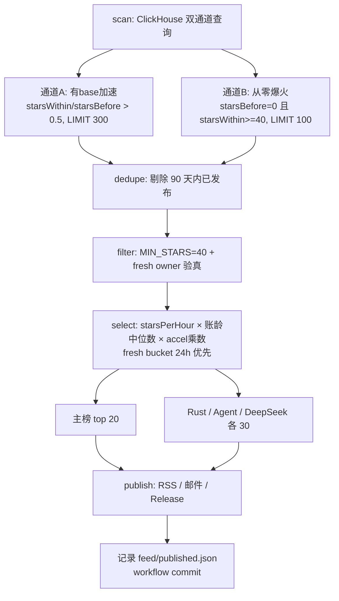
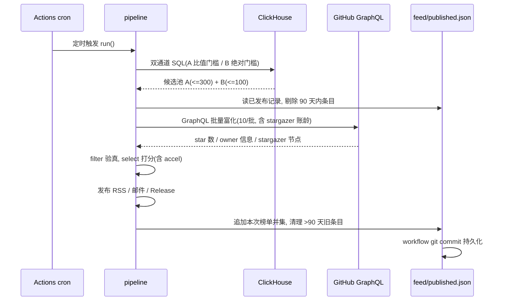

# Spec 0001: 新项目通道 + 加速度打分 + 发布去重

- 状态: 已确认(2026-09-19 用户批准, 调整: 通道 B LIMIT=100, 垂直榜各 30)
- 日期: 2026-09-19
- 关联: docs/adr/0002(垂直榜模式, 本 spec 沿用其 fail-closed 与单一评分口径原则)

## 1. 背景与目标

当前 pipeline 只能发现"已有 base 且窗口内增量 > 0.5 倍存量"的项目。
`HAVING starsBefore > 0` 使**窗口内从零起爆的项目必然进不了候选池**(详见 notes.md 2026-09-19 验证: 7 天内 116 个 starsBefore=0 且 starsWithin>=40 的项目, 合计 10949 star, 可见度为零)。

同时 pipeline 缺少加速度(二阶导)信号, 无法区分"正在起飞"与"已经到顶";
daily 频率下没有已发布记忆, 爆火项目会连续霸榜挤掉新面孔。

目标:

1. 新增"从零爆火"扫描通道, 与现有通道合并进同一评分口径
2. 打分引入加速度乘数
3. 发布后记录去重, 榜单不再重复推同一项目
4. FILTER_MIN_STARS 200 → 40(用户拍板: 小众垂直低 star 项目也值得关注)
5. 开启 FILTER_FRESH_OWNER, 挡住从零通道实测高发的盗版钓鱼仓库

## 2. 已验证的发现(动态证据)

验证 SQL 与 pipeline 同口径(60 天时间轴上算真实 starsBefore):

```sql
starsBefore = countIf(WatchEvent AND created_at < now() - 7 DAY)   -- 真实历史
starsWithin = countIf(WatchEvent AND created_at >= now() - 7 DAY)
HAVING starsBefore = 0 AND starsWithin >= 40
```

- 命中 116 个项目, 合计 10949 star, 最高单项目 352(2026-09-19 实测)
- top25 明细约一半为盗版钓鱼(KMS-Pico / AutoCad-setup / Cinema-4D 系列,
  owner 为随机词组新账号), 真项目如 browser-use/jev-ultrafast(345)、
  shadcn-ui/lint(211)、lynote-ai/humanize-text(150)
- 结论: 通道 B 必须搭配 fresh owner 检测, 否则榜单会被钓鱼仓库污染

第一版验证 SQL(把 WHERE 限在 7 天内)有窗口截断缺陷, 混入老项目翻红,
其数字(602/71379)作废, 教训见 notes.md。

## 3. 设计

### D1 双通道 SQL(src/clients/clickhouse.ts)

在现有 `trendingReposQuery` 上扩展为 UNION ALL 双通道, 一次查询完成:

```sql
-- 通道 A: 有 base 的加速(现有逻辑, 不动)
SELECT repo_name, starsBefore, starsWithin, starsRecent, starsEarlier, firstSeenAt
FROM ... GROUP BY repo_name
HAVING starsBefore > 0 AND starsWithin / starsBefore > MIN_GROWTH_RATE
ORDER BY starsWithin DESC LIMIT LIMIT_N

UNION ALL

-- 通道 B: 从零爆火(新增)
SELECT repo_name, starsBefore, starsWithin, starsRecent, starsEarlier, firstSeenAt
FROM ... GROUP BY repo_name
HAVING starsBefore = 0 AND starsWithin >= CHANNEL_B_MIN_STARS
ORDER BY starsWithin DESC LIMIT CHANNEL_B_LIMIT
```

- 两通道 starsBefore 条件互斥(>0 vs =0), 天然无重复, 无需外层去重
- 通道 B 配额: `SCAN_CHANNEL_B_LIMIT=100`(用户拍板)
- WHERE 时间轴加 60 天下界(`SCAN_HISTORY_DAYS=60`, 新配置; 原 SQL 无下界,
  扫全历史): starsBefore 的判定需要窗口之前的真实历史; 60 天内创建的项目 starsBefore
  精确为 0, 更早的老项目几乎必然有历史 WatchEvent(窗口前零 star 且突然
  爆火的"老项目复活"也会被 B 通道抓到, 行为上与新项目等价, 可接受)
- `starsRecent` / `starsEarlier`(新增列): 窗口劈半的 WatchEvent 计数,
  供 D2 计算加速度
- `ClickHouseRepo` 类型新增 starsRecent / starsEarlier 字段
- 通道 B 门槛建议 40(与 FILTER_MIN_STARS 对齐; CH 采样约为真实值一半,
  真实 star >= 80, 可通过 filter 的 40 门槛)

### D2 加速度乘数(src/pipeline/select.ts)

在 `rankAndSlice` 的打分中引入 accel:

```text
accel = clamp((starsRecent + 1) / (starsEarlier + 1), 0.5, 3)
score = starsPerHour × (medianStargazersAge / 365) × (1 + W × (accel - 1))
```

- `+1` 平滑: 防除零, 同时给通道 B(前半窗为 0)一个有限高值而非无穷
- clamp [0.5, 3]: 乘数范围 [1 - 0.5W, 1 + 2W], W=0.5 时即 [0.75, 2.0],
  防止单一 accel 维度支配排序
- `SELECT_ACCEL_WEIGHT=0.5`(新配置), 设 0 时乘数恒为 1, 完全等价现行为(可灰度回滚)
- 通道 B 项目 firstSeen 在窗口内, 天然 fresh, 优先级有保障
- 附带实现(2026-09-21 评审后保留): `hoursSinceFirstSeen` 扣除 eval 回溯偏移
  (`- daysSinceEval*24`), 与既有账龄的 eval 补偿对齐; 线上默认
  (无 SCAN_EVAL_DATE)行为不变, 仅历史回溯模式下 fresh bucket 判定生效

### D3 发布去重(src/pipeline/dedupe.ts 新文件 + run.ts 接线 + workflow)

- 记录文件 `feed/published.json`: `{"owner/name": "YYYY-MM-DD", ...}`
- run.ts 在 scan 之后、filter 之前调用 `dedupe(repos, memoryPath)`:
  剔除 90 天内已发布过的项目(90 天自动清理, 控制文件体积)
- 发布成功后 `recordPublished(selectedRepos, memoryPath)` 追加本次四榜单并集,
  并清掉 >90 天旧条目
- 位置放 select 之前(全局生效), release 与 RSS 榜单口径一致
- `PUBLISHED_MEMORY_ENABLED=true`(新配置); false、文件缺失或 JSON 损坏时
  行为与现状完全一致(降级全通过 + WARN, 发布永不被去重记忆挡住)
- workflow 改动: update-rss.yml / publish-gh-release.yml 在 pipeline 成功后
  `git commit feed/published.json`(update-rss 已有 commit rss.xml 的权限模式,
  实现时核对该 workflow 的 permissions 与 commit 步骤写法, 保持一致)
- 本地 preview(`preview:live`)不写记录文件, 只读

### D4 FILTER_MIN_STARS 200 → 40(.env.example)

- 直接生效于 filter.ts 现有分支, 无代码改动
- 联动评估: 过滤更少 → fail-closed guard(remainingPercent < 50)更安全;
  打分池变大, 榜单竞争自然加剧, RELEASE_TOP_N 不需要动

### D5 FILTER_FRESH_OWNER false → true(.env.example)

- 启用 filter.ts 现有的"owner 账龄 < 30 天剔除"分支(原作者为 crypto
  wallet drainer 设计), 是通道 B 信噪比的硬依赖, 静态分析+明细实测双重依据
- org owner 不受影响(browser-use 等组织项目可正常入榜)
- 误伤面: 刚注册 GitHub 的新作者的个人项目, 占比低, 接受

## 4. 配置变更总表(.env.example)

| 键 | 现值 | 新值 | 说明 |
|---|---|---|---|
| FILTER_MIN_STARS | 200 | 40 | 用户拍板 |
| FILTER_FRESH_OWNER | false | true | 通道 B 防钓鱼 |
| RELEASE_TOP_N_RUST / _AGENT / _DEEPSEEK | 15 | 30 | 用户拍板, 垂直榜扩容 |
| SCAN_HISTORY_DAYS | (无, 硬编码 7 天 WHERE) | 60 | starsBefore 判定时间轴 |
| SCAN_CHANNEL_B_MIN_STARS | (无) | 40 | 通道 B 绝对门槛 |
| SCAN_CHANNEL_B_LIMIT | (无) | 100 | 通道 B 配额(用户拍板) |
| SELECT_ACCEL_WEIGHT | (无) | 0.5 | 加速度权重, 0 = 关闭 |
| PUBLISHED_MEMORY_ENABLED | (无) | true | 发布去重开关 |

SCAN_MIN_GROWTH_RATE=0.5 / SCAN_LIMIT=300 / SELECT_FRESH_HOURS=24 保持不变。

## 5. 改后 pipeline 流程





## 6. 测试计划(vitest, 沿用 tests/ 现有结构)

1. clickhouse.ts: SQL 生成函数断言(含通道 B HAVING 子句、accel 两列、
   SCAN_HISTORY_DAYS 插值)
2. select.ts: accel 乘数边界(earlier=0 平滑、clamp 上下限、W=0 等价旧行为)、
   fresh bucket 与 accel 组合排序
3. dedupe.ts: 剔除命中/文件缺失降级/90 天清理/四榜单并集写入
4. filter.ts: MIN_STARS=40 边界、fresh owner 开启后的 User/Organization 分支
5. 回归: 现有 tests/run.test.ts 全绿
6. 集成冒烟: `USE_MOCK_REPOS=false SCAN_EVAL_DATE=2026-09-12 pnpm run preview:live`
   回溯验证——2026-09-12 前一周正处 9/12 前后, 通道 B 应能捞出当天从零起爆的项目

## 7. 风险与回滚

| 风险 | 缓解 |
|---|---|
| 通道 B 垃圾占比高污染榜单 | fresh owner + 40 star 门槛 + medianAge 打分三重压制; 上线观察一周, 必要时 SCAN_CHANNEL_B_MIN_STARS 提到 60 |
| 查询时间变长 | WHERE 限制 60 天; 双通道一次查询, 增量开销为单次扫描 |
| published.json 并发 commit 冲突 | 两个 workflow 定时错开; 冲突时 pull --rebase 重试 |
| accel 扭曲排序 | SELECT_ACCEL_WEIGHT=0 一键回退等价旧行为 |
| 新项目通道误伤(fresh owner 拦掉刚注册的真作者) | 占比低接受; org 账号不受影响 |

## 8. 本期不做(避免一次改太大)

- P1 上游信号: HN Algolia 提及、npm/crates 下载增速
- P2: stargazer followers / star 时间分布熵 / issue-fork 验真 / LLM 语义分类
- P3: 历史曲线相似匹配
- CJK 过滤策略调整(如需中文项目榜, 另立 spec)
